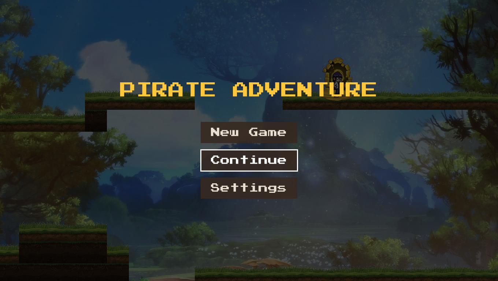
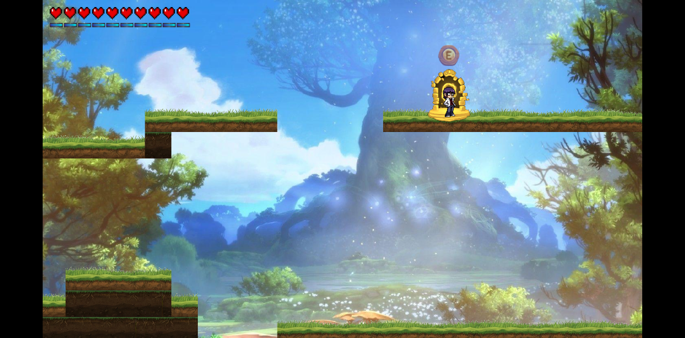
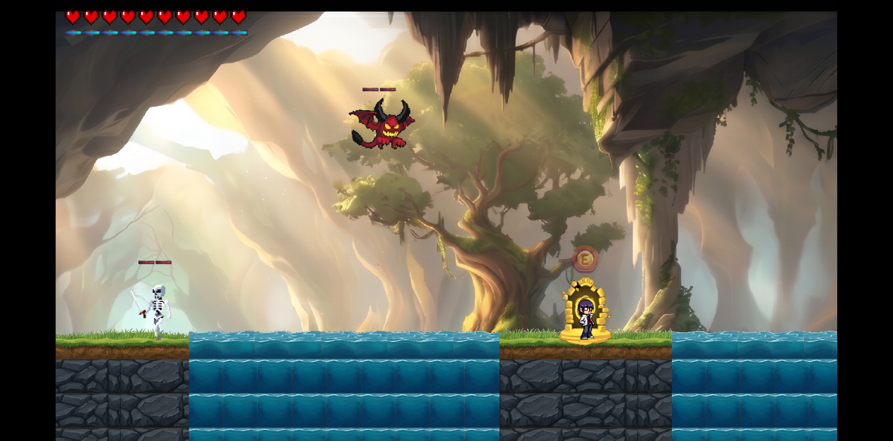
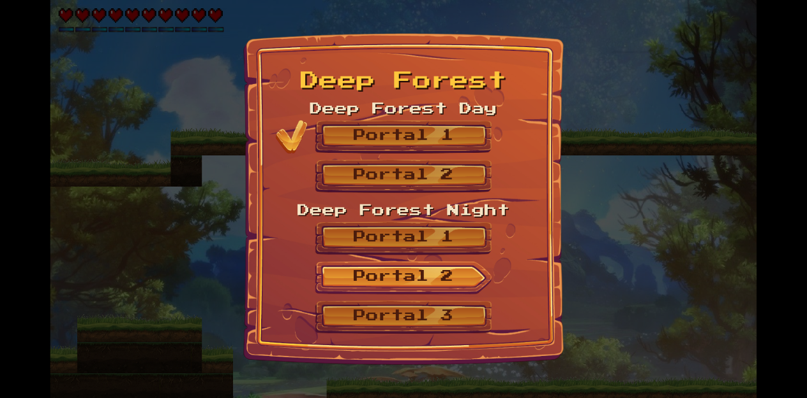

# Pirate Adventure

**▶ [Play in browser](https://go-game-dfjz.onrender.com)** (free hosting: the first load takes about 30 s to wake the server)

[](https://github.com/shoonya0/Go-Game/actions/workflows/ci.yml)

A 2D side-scrolling platformer built from scratch in Go on
[Ebitengine](https://ebitengine.org/). It runs as a native Windows game and in the browser
(WebAssembly). **Version 1.0.**



## The game

Explore eight levels, each with a day and a night stage. Fight skeletons, mushrooms, golems
and flying demons with slashes, combos and special powers. Save at stone portals and travel
between them.



- **Combat:** quick and high slashes, air attacks, two-hit specials (twin crescents, a blue
  disc, burst and thrust) and a ground wave. Every attack costs stamina or is free; the How to
  Play pages list the damage of each one.
- **Enemies:** six kinds (white and yellow skeletons, mushroom, White Golem, Flying Demon,
  Smasher). They patrol, chase you, wade through water, fly around platforms and guard the
  place where they lost you.
- **Hazards:** water slows you and slowly drains health, larva burns, long falls hurt.
- **Portals:** stand in one and press **E** to save. Hold **E** to open the travel menu and
  jump to any portal you have used. Use every portal of a stage to open the next one.
- **Menus:** title screen, Continue from your autosave, settings, pause menu, and How to
  Play pages in the settings.
- **Touch screens:** on-screen buttons for every action.





## Controls

| Key | Action |
|---|---|
| A / D | Walk left and right |
| W / S | Pick in menus |
| Space | Jump |
| Shift (hold) | Run (uses stamina) |
| J / I | Quick slash / high slash (in the air: air slash / air smash) |
| K K, L L, O O | Special attacks; press again for the second hit |
| U | Ground wave |
| E | Save at a portal; hold to travel |
| F | Tease the enemies |
| Esc | Pause |
| F3 | Show hit boxes |

## Engineering

- **One codebase, two targets:** the same Go code builds a native Windows game and a
  WebAssembly bundle served by a small stdlib-only server (Docker image on Render).
- **Quadtree spatial partitioning** for collision checks between the player, enemies and terrain.
- **Save system behind build tags:** a file in the user's config folder on desktop,
  `localStorage` in the browser; the game code only (de)serializes.
- **220+ unit tests**, plus vet, golangci-lint (with layer rules) and native + WASM builds in CI.

## Run it

You need [Go 1.24](https://go.dev/dl/) or newer.

```sh
go run ./cmd
```

To play in the browser, build the WebAssembly bundle and start the small server, then open
http://localhost:8080. `DEPLOY.md` has the commands for Windows and Linux and the Docker
image used on Render.

```sh
GOOS=js GOARCH=wasm go build -ldflags="-s -w" -o web/game.wasm ./cmd
cp "$(go env GOROOT)/lib/wasm/wasm_exec.js" web/
go run ./server
```

## Project layout

| Path | What is there |
|---|---|
| `cmd/` | Entry point: window, menus and the game loop |
| `internal/core/` | The game: player, enemies, levels, portals, menus, HUD |
| `internal/system/` | Platform code (save file on desktop, `localStorage` on the web) |
| `assets/` | Sprites, tiles, level grids and backgrounds, embedded with `go:embed` |
| `_futureAssets/` | Art packs not used yet (bat, bosses, Mossy tileset, plants, Striker) |
| `server/` | Static file server for the web build |
| `_docs/` | Architecture, feature docs and the current state |

## Checks

```sh
node scripts/verify.mjs          # gofmt, vet, lint, unit tests, docs check
node scripts/verify.mjs --full   # also the native and WebAssembly builds
```
